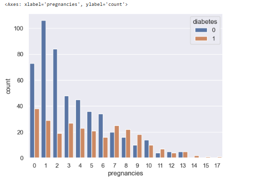
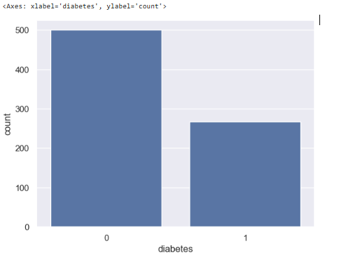

# Diabetes Prediction Using Machine Learning

## Project Overview

This project explores the application of machine learning classification algorithms to predict whether an individual has diabetes based on selected health-related features.

The project follows a typical machine learning workflow, starting with exploratory data analysis (EDA), followed by data preparation, model training, prediction, and performance evaluation.

I experimented with multiple classification algorithms and investigated how adjusting the classification threshold affects model performance, particularly precision and recall.

The goal was not only to build a predictive model but also to understand how different algorithms perform and how model evaluation metrics can influence the choice of a final model.

## Objectives

- Perform exploratory data analysis to understand the dataset.
- Identify patterns and relationships between health features and diabetes outcomes.
- Train and evaluate multiple machine learning classification algorithms.
- Compare model performance using classification metrics.
- Investigate the effect of different classification thresholds.
- Select a suitable model based on its predictive performance.

## Dataset

The project uses a cleaned diabetes dataset stored in `data/diabetes_clean.csv`.

The dataset contains health-related features used to predict the target variable:

- **Target variable:** `diabetes`
- **Features:** Health indicators, including pregnancies and other patient-related measurements.

The dataset was loaded and explored using Pandas to understand its structure, descriptive statistics, and feature distributions.

## Technologies & Libraries

| Technology | Purpose |
|---|---|
| Python | Programming language |
| NumPy | Numerical computations |
| Pandas | Data manipulation and analysis |
| Matplotlib | Data visualization |
| Seaborn | Statistical visualization |
| Scikit-learn | Model training and evaluation |

## Project Workflow

### 1. Exploratory Data Analysis (EDA)

The first stage involved examining the dataset to understand its structure and identify patterns.

Some of the visualizations explored include:

- Distribution of diabetes and non-diabetes cases.
- Relationship between pregnancies and diabetes outcomes.
- Descriptive statistics of the dataset.

**Visualizations**


#### Pregnancies vs Diabetes





### 2. Data Preparation

The dataset was separated into independent and dependent variables.

- **X:** Independent variables (features).
- **y:** Dependent variable (`diabetes`).

The dataset was split into training and testing sets using:

- Training set: 70%
- Testing set: 30%
- Random state: 42
- Stratification: Applied to preserve the target class distribution.

### 3. Model Training

I experimented with the following classification algorithms:

1. K-Nearest Neighbors (KNN)
2. Naive Bayes
3. Support Vector Machine (SVM)
4. Random Forest Classifier
5. Logistic Regression

For Logistic Regression, I used a Scikit-learn Pipeline containing `StandardScaler` to standardize the input features before model training.

### 4. Model Evaluation

The models were evaluated using the following metrics:

| Metric | Explanation |
|---|---|
| Accuracy | Proportion of all predictions that were correct. |
| Precision | Of all positive predictions, the proportion that were actually positive. |
| Recall | Of all actual positive cases, the proportion correctly identified by the model. |
| F1-score | Harmonic mean of precision and recall. |

I also measured prediction time to get an idea of the computational cost of making predictions with each model.

### 5. Classification Threshold Analysis

An important part of this project was investigating how the classification threshold affects model performance.

Instead of relying entirely on the default threshold of 0.50, I experimented with different thresholds ranging from 0.25 to 0.70.

The model's predicted probabilities were converted into binary predictions using different threshold values.

This allowed me to observe how changing the threshold affects:

- Accuracy
- Precision
- Recall
- F1-score

**Selected threshold: 0.40**

Based on my threshold experiments, 0.40 was selected as the preferred threshold for the Logistic Regression model.

This experiment helped demonstrate that model performance is not determined by the algorithm alone; the decision threshold also plays an important role.

## Model Selection

### Logistic Regression

Logistic Regression was selected as the preferred model from my experiments.

It achieved an accuracy of approximately **74%**.

Reasons for selecting Logistic Regression:

- Competitive predictive performance.
- Relatively simple and interpretable classification approach.
- Standardized features using `StandardScaler`.
- Ability to generate class probabilities, allowing threshold experimentation.

The threshold analysis also provided an opportunity to investigate the trade-offs between precision and recall.

## Project Structure

```text
diabetes-prediction/
│
├── data/
│   └── diabetes_clean.csv
│
├── images/
│   ├── count.png
│   └── preg.png
│
├── notebooks/
│   └── diabetes_prediction.ipynb
│
├── README.md
```


## Key Learnings

Through this project, I gained practical experience in:

- Performing exploratory data analysis.
- Understanding relationships between features and target variables.
- Preparing datasets for supervised machine learning.
- Training and comparing different classification algorithms.
- Understanding classification metrics beyond accuracy.
- Experimenting with classification thresholds.
- Using Scikit-learn Pipelines for preprocessing and model training.
- Understanding the trade-off between precision and recall.

## Future Improvements

- Perform hyperparameter tuning for the different classification algorithms.
- Use cross-validation to obtain more reliable model performance estimates.
- Explore confusion matrices and ROC-AUC curves.
- Investigate feature importance and feature selection.
- Compare models using a consistent evaluation framework.
- Evaluate the final model on an independent dataset.

## Disclaimer

This project is for educational and experimental purposes only. It is not intended to diagnose diabetes or replace professional medical advice.


**Project Type:** Supervised Machine Learning | Binary Classification